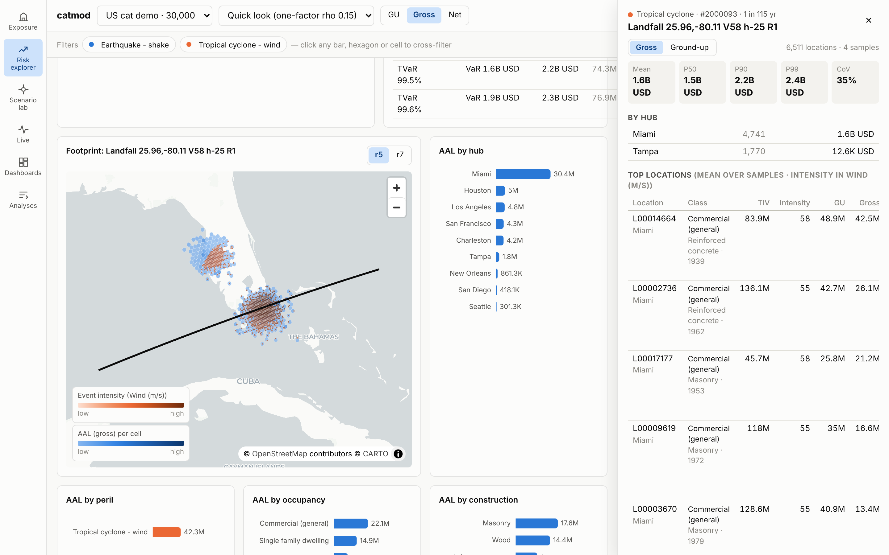
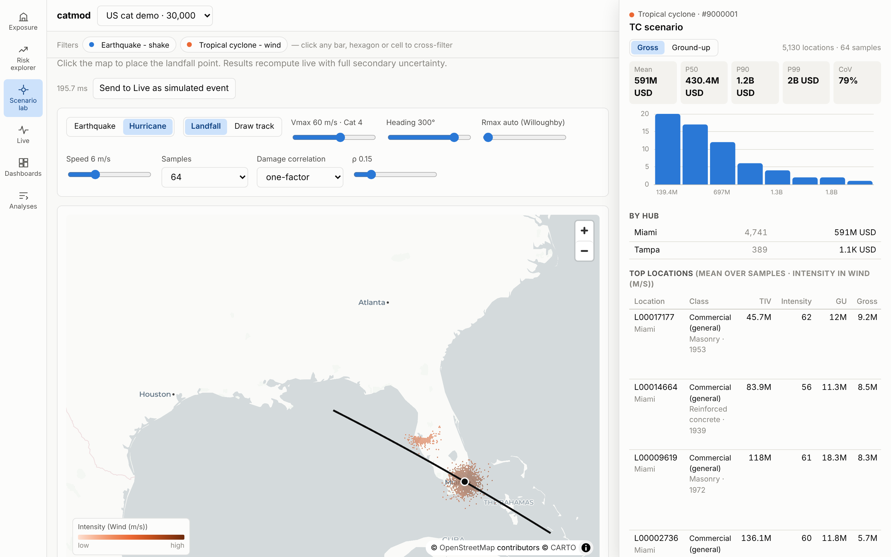

# catmod

**Open-source, interactive catastrophe modelling** — a transparent hazard → vulnerability → financial
engine with pluggable correlation models, live event nowcasting, a scenario lab, and a cross-filtering
map/widget explorer. API-first, declarative, reproducible.



## What it does

| | |
|---|---|
| **Stochastic engine** | Earthquake (Gutenberg–Richter faults & zones, GMM with Vs30) and tropical cyclone (US landfall catalogue, Holland wind field, Kaplan–DeMaria decay). Beta secondary uncertainty, OED location & account terms, quota share + XoL with reinstatements. ELT → Poisson YLT → AAL, OEP/AEP, VaR/TVaR **with standard errors**. |
| **Pluggable correlation** | Hazard residual fields `independent` · `cholesky` · `fft` (circulant embedding) and damage copulas `independent` · `one_factor` (by construction) · `spatial` (distance-decaying). Swap per run; extend via entry points; `catmod benchmark` shows the tail impact. |
| **Explorer** | MapLibre + deck.gl H3 maps, EP curves, breakdowns, treemap, heatmap, event tables — one filter state cross-filters everything (incl. server-side EP by hub/occupancy/construction/peril) and lives in the URL. Click an EP point → events at that return period → footprint on the map → top locations with their terms. |
| **Scenario lab** | Click to place an epicentre or landfall, or draw a track; sliders for magnitude, depth, strike, Vmax, heading, Rmax, copula ρ. Full loss distribution recomputes in ~200 ms. |
| **Live** | USGS earthquakes and NOAA NHC storms → ensemble nowcasts on watched portfolios → alert rules → WebSocket push and toasts. Inject simulated events for drills. |
| **Configurability** | Every model knob is a validated config field (`schemas/analysis-config.schema.json`); declarative dashboards (JSON widget specs); ⌘K command palette; keyboard view switching (1–6). |



## Quick start

```bash
make setup          # uv sync + npm ci
make api            # http://127.0.0.1:8000/docs   (CATMOD_LIVE=1 to poll feeds)
make web            # http://localhost:5173
# or the whole stack:
make up             # http://localhost:8080
```

Then: **Exposure → New portfolio** → **Analyses → Run analysis** (the *quick* preset takes seconds) →
**Risk explorer**. Press **⌘K** for everything else.

### CLI

```bash
cd backend
uv run catmod generate --preset us-cat-demo --n 50000 --out ../data/demo           # OED CSV + Parquet
uv run catmod run --portfolio ../data/demo --preset quick --out ../data/demo-run    # ELT/YLT/metrics
uv run catmod benchmark --portfolio ../data/demo --preset quick --rho 0.3           # copula comparison
uv run catmod scenario --portfolio ../data/demo --peril QEQ \
    --event '{"lat":34.02,"lon":-118.32,"magnitude":7.1}'
```

### Python SDK (stdlib only)

```python
from catmod.sdk import Client
c = Client("http://localhost:8000")
p = c.create_portfolio(n_locations=20_000)
run = c.run(p["id"], preset="quick", damage_correlation={"model": "spatial", "rho": 0.3})
miami = c.ep(run["id"], perspective="gross", hub=["Miami"])        # filtered EP on the server
s = c.scenario(p["id"], "WTC", {"lat": 25.7, "lon": -80.2, "vmax_ms": 64, "heading_deg": 300})
```

## API

The OpenAPI document (`schemas/openapi.json`, served at `/docs`) is the contract; the web client's
TypeScript types are generated from it and CI fails on drift. Highlights:

| | |
|---|---|
| `POST /api/v1/portfolios` | generate from preset / config |
| `POST /api/v1/runs[?wait=true]` | run an analysis (preset + overrides, or full config); progress on `/ws` |
| `GET /api/v1/runs/{id}/ep?perspective=&peril=&hub=&occupancy=&construction=` | filtered EP + metrics + SEs |
| `GET /api/v1/runs/{id}/breakdown?by=hub\|peril\|occupancy\|construction\|h3` | AAL roll-ups |
| `GET /api/v1/runs/{id}/events-at-rp?rp=250` | events driving a return period |
| `GET /api/v1/runs/{id}/events/{event_id}` | deterministic drill-down: footprint, top locations, sample losses |
| `GET /api/v1/runs/{id}/locations.arrow` | Arrow IPC (exposure + per-peril AAL) for client crossfilter |
| `POST /api/v1/scenarios` | one event, full secondary uncertainty |
| `GET/POST /api/v1/live/*`, `/api/v1/alerts/*` | feeds, nowcasts, injection, alert rules |
| `/api/v1/dashboards` | declarative dashboard specs |
| `WS /ws` | `run.progress`, `run.status`, `live.event`, `alert`, `portfolio.created` |

Set `CATMOD_API_KEY` to require `x-api-key` (or `?api_key=` for the WebSocket).

## Architecture

```
 web (React/TS)  ── typed client (OpenAPI) ── JSON ─┐
   MapLibre + deck.gl · ECharts · Arrow crossfilter │  Arrow IPC / Parquet
                                                    ▼
 FastAPI ─ runs (spawn process pool) ─ scenarios ─ live (USGS/NHC poller) ─ WebSocket hub
   │
 engine: hazard (EQ, TC, plugins) → spatial field → vulnerability (Beta) → copula
         → financial (loc / account / reinsurance) → ELT → YLT → metrics
   │
 storage: Parquet (zstd) + DuckDB; per-event seeding ⇒ any event recomputes bit-for-bit
```

Performance on 4 cores: 50k-location portfolio, 3,000-event catalogue, 8 samples/event, 50k years
→ **~60 s** full run; quick preset on 30k locations → **~4 s**; scenario / nowcast → **~200 ms**.

## Validation

`backend/tests` (66 tests) include statistical and closed-form checks, not just plumbing:
FFT vs exact-Cholesky correlation, copula ρ recovery, Beta-moment and inverse-CDF accuracy, a
**generalised Vasicek large-portfolio limit** for the one-factor copula, wind field vs great-circle
brute force, spatial-index exactness, deductible/layer/reinsurance algebra, simulated vs analytic AAL
convergence, segment-EP additivity, and worker-count-independent determinism.
See [docs/methodology.md](docs/methodology.md) for the maths and limitations.

> Hazard, vulnerability and climatology parameters are **illustrative** defaults, not a licensed view of
> risk. Replace them via config or plugins for decision-making.

## Repository

```
backend/   catmod: engine/, api/, live/, exposure/, cli.py, sdk.py   (uv · ruff · mypy --strict · pytest)
web/       React + TypeScript explorer (Vite)
schemas/   generated contracts: portfolio-config, analysis-config, OpenAPI
docker/    API + nginx images (WebSocket-aware proxy)
docs/      methodology, ADRs, roadmap
```

## License

[Apache-2.0](LICENSE)
